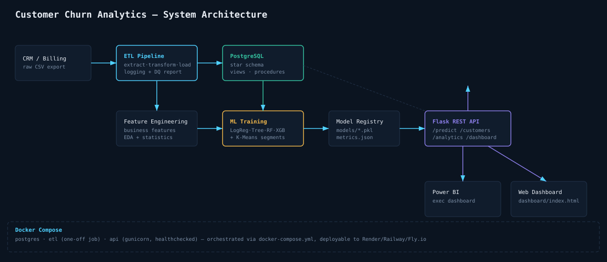

# Customer Churn Prediction & Business Intelligence Platform

**An end-to-end analytics platform that identifies at-risk telecom customers and turns that prediction into a business action** — built to demonstrate the full Data Analyst / Business Analyst skill set: SQL, Python, ETL, statistics, ML, and BI dashboarding, in one coherent, production-shaped project (not a notebook-only tutorial).

   

---

## Live Demo

- **Interactive Web Dashboard:** open `dashboard/index.html` in any browser (no server needed — data is pre-bundled). Deploy as a static site to GitHub Pages / Netlify / Vercel in one click for a shareable resume link.
- **REST API:** `python app.py` → `http://localhost:5000` (see [API Reference](#api-reference) below)
- **Power BI:** see `reports/PowerBI_Build_Guide.md` for a 15-minute guide to recreate the same 5 pages against the live database, with all DAX measures included.

---

## The Business Problem

A telecom company needs to know **who is about to churn, why, and what to do about it** — before the customer leaves, not after. This platform:

1. Predicts churn probability per customer (4 ML models compared, best one selected and explained)
2. Explains the key drivers in plain business language, backed by hypothesis testing
3. Segments customers into actionable personas via unsupervised clustering
4. Quantifies revenue at risk and recommends who to contact first
5. Serves everything through a REST API and an executive BI dashboard

Full framing: [`reports/Business_Recommendations.md`](reports/Business_Recommendations.md)

---

## Architecture



```
Raw CSV (simulated CRM export, intentionally messy)
    → ETL Pipeline (extract/transform/load, logged, validated)
    → PostgreSQL (normalized star schema: dim_customers, dim_billing, dim_services, fact_churn...)
    → Feature Engineering (11 business-meaningful engineered features)
    → EDA + Statistical Testing (10 charts, 9 hypothesis tests, all interpreted in business language)
    → ML Training (Logistic Regression, Decision Tree, Random Forest, XGBoost — compared & best selected)
    → K-Means Segmentation (5 business-readable customer personas)
    → Flask REST API (serves predictions + aggregated analytics)
    → Power BI / Web Dashboard (executive-facing visualization layer)
```

Entity relationship diagram: [`reports/er_diagram.svg`](reports/er_diagram.svg)

---

## Tech Stack

| Layer | Tools |
|---|---|
| Language | Python 3.11 |
| Data manipulation | Pandas, NumPy |
| Database | PostgreSQL 16 (SQLite fallback for local dev) |
| ORM / DB access | SQLAlchemy |
| Statistics | SciPy |
| ML | scikit-learn, XGBoost |
| Visualization | Matplotlib, Seaborn, Chart.js (web dashboard) |
| API | Flask + Gunicorn |
| BI | Power BI (DAX measures provided) + custom web dashboard |
| Containerization | Docker, Docker Compose |
| Notebooks | Jupyter |

---

## Project Structure

```
Customer-Churn-Analytics/
├── data/
│   ├── raw/               # Simulated messy CRM export
│   ├── cleaned/            # Post-ETL, validated data
│   └── processed/           # Feature-engineered + segmented data
├── database/
│   ├── schema.sql          # Normalized star schema, indexes, triggers
│   ├── views.sql             # Analytical views for BI consumption
│   ├── procedures.sql          # Stored procedures & functions (CLV calc, normalization)
│   └── analytical_queries.sql    # 50+ advanced SQL queries (joins, CTEs, window functions)
├── notebooks/
│   ├── EDA.ipynb
│   ├── FeatureEngineering.ipynb
│   └── ModelTraining.ipynb
├── src/
│   ├── ETL/                 # generate_raw_data.py, etl_pipeline.py
│   ├── preprocessing/         # feature_engineering.py
│   ├── visualization/          # eda_report.py, statistical_analysis.py
│   ├── modeling/                 # train_models.py, customer_segmentation.py
│   └── api/                        # app.py (Flask REST API)
├── dashboard/
│   ├── index.html                    # Interactive web BI dashboard (5 pages)
│   └── dashboard_data.json             # Pre-aggregated snapshot data
├── reports/                              # All generated reports, figures, diagrams
├── models/                                 # Trained model artifacts (generated)
├── Docker/                                   # Dockerfile.api, Dockerfile.etl
├── app.py                                      # Root API entrypoint
├── docker-compose.yml
└── requirements.txt
```

---

## Quickstart

### Option A — Local Python (fastest way to explore)

```bash
git clone <your-repo-url>
cd Customer-Churn-Analytics
python -m venv venv && source venv/bin/activate   # Windows: venv\Scripts\activate
pip install -r requirements.txt

# Run the full pipeline, in order:
python src/ETL/generate_raw_data.py          # simulate the raw CRM export
python src/ETL/etl_pipeline.py                 # clean, validate, load to database/churn.db (SQLite by default)
python src/preprocessing/feature_engineering.py  # engineer model features
python src/visualization/eda_report.py             # generate EDA charts + report
python src/visualization/statistical_analysis.py    # hypothesis tests
python src/modeling/train_models.py                    # train & compare 4 ML models
python src/modeling/customer_segmentation.py              # K-Means personas

# Regenerate the dashboard's data snapshot after any pipeline change:
# (see "Refreshing the dashboard" below)

python app.py                                                # start the API on :5000
```

Then open `dashboard/index.html` directly in your browser.

### Option B — Docker Compose (production-shaped)

```bash
cp .env.example .env      # edit credentials if needed
docker compose up --build
```

This spins up PostgreSQL, runs the ETL pipeline as a one-off job, then starts
the Flask API on `:5000` behind Gunicorn with a healthcheck.

### Option C — PostgreSQL manually

```bash
psql -U youruser -d churn_db -f database/schema.sql
psql -U youruser -d churn_db -f database/views.sql
psql -U youruser -d churn_db -f database/procedures.sql
# then run the ETL pipeline with DATABASE_URL pointing at your Postgres instance,
# followed by: SELECT churn_analytics.normalize_staging_to_star();
```

---

## API Reference

| Method | Endpoint | Description |
|---|---|---|
| GET | `/health` | Liveness check |
| POST | `/predict` | Single or batch churn prediction (JSON body) |
| GET | `/customers?page=1&page_size=25&region=&contract=&churn=` | Paginated, filterable customer listing |
| GET | `/customers/<customerID>` | Full 360° view of a single customer |
| GET | `/analytics` | Aggregate KPIs: churn rate, MRR, ARPU, at-risk revenue, by-contract/region breakdowns |
| GET | `/analytics/segments` | Persona-level summary |
| GET | `/dashboard` | Single aggregated payload consumed by the web dashboard |

Example prediction request:

```bash
curl -X POST http://localhost:5000/predict -H "Content-Type: application/json" -d '{
  "customerID": "CUST-999999", "tenure": 3, "MonthlyCharges": 95.5, "TotalCharges": 286.5,
  "SupportTicketsLastYear": 4, "ContractDurationMonths": 1, "TotalAddOnServices": 0,
  "CustomerValueScore": 55.2, "IsAutoPay": 0, "HasInternetNoProtection": 1,
  "IsMultiServiceHousehold": 0, "SeniorCitizen": 0, "gender": "Male", "Partner": "No",
  "Dependents": "No", "InternetService": "Fiber optic", "Contract": "Month-to-month",
  "PaymentMethod": "Electronic check", "PaperlessBilling": "Yes"
}'
```

```json
{"churn_probability": 0.9455, "customerID": "CUST-999999", "model_version": "Logistic Regression", "risk_segment": "High"}
```

---

## Key Findings

- **Contract type is the strongest churn lever**: month-to-month customers churn at roughly double the rate of two-year contract holders (chi-square test, p < 0.001 — see `reports/Statistical_Analysis_Report.md`)
- **The first 12 months are the highest-risk window** — tenure and churn are significantly negatively correlated (independent t-test, p < 0.001)
- **Electronic check payers churn more** than autopay customers — a low-cost nudge-to-autopay campaign is a quick win
- Best model: **selected automatically by ROC-AUC + recall** — see `reports/Model_Comparison_Report.md` for the live comparison table and rationale (recall is weighted because a missed churner costs more than an unnecessary retention offer)
- 5 customer personas identified via K-Means, ranging from 38% to 75% churn rate — see `reports/Customer_Segmentation_Report.md`

Full write-up: [`reports/Business_Recommendations.md`](reports/Business_Recommendations.md)

---

## Refreshing the Dashboard

The web dashboard reads a static JSON snapshot (`dashboard/dashboard_data.json`) so it works
with zero backend for demos. To regenerate it after re-running the pipeline:

```bash
python src/visualization/build_dashboard_snapshot.py
```

(or point the dashboard at the live `/dashboard` API endpoint for real-time data — swap the
`fetch('dashboard_data.json')` call in `dashboard/index.html` for your deployed API URL)

---

## Testing

```bash
pytest tests/ -v
```

See `tests/` for data validation, ETL, and API endpoint tests.

---

## Deployment Notes

- **API**: `Docker/Dockerfile.api` is ready to deploy to Render, Railway, Fly.io, or any
  container host. Set `DATABASE_URL` as an environment variable pointing at a managed
  Postgres instance (e.g., Render Postgres, Supabase, RDS).
- **Dashboard**: `dashboard/` is a fully static site — deploy directly to GitHub Pages,
  Netlify, or Vercel with zero build step.
- **Scheduled retraining**: wire `Docker/Dockerfile.etl` into a cron job or GitHub Actions
  workflow to retrain the model on a rolling basis as new data arrives.

---

## Author Notes for Reviewers

This project uses a **synthetic dataset** (`src/ETL/generate_raw_data.py`) generated with
realistic feature relationships and deliberately injected data-quality issues (missing
values, duplicates, inconsistent labels, outliers, mixed date formats) so the ETL and
cleaning steps do real work rather than operating on an already-pristine CSV. Churn labels
are generated from a logistic function of realistic drivers (contract type, tenure, price,
support tickets) plus noise — not random — so EDA, statistics, and ML all find genuine,
explainable signal.

See [`reports/Data_Dictionary.md`](reports/Data_Dictionary.md) for full field documentation
across all four data layers (raw → cleaned → feature-engineered → segmented).
