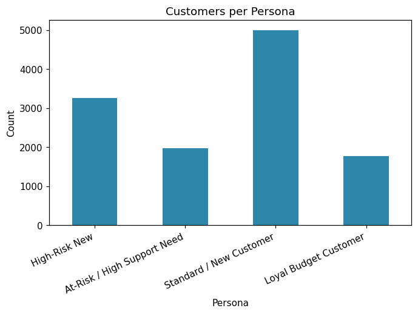

# Customer Segmentation Report

K-Means with k=5 clusters, silhouette score at k=5: 0.255

## Persona Summary

| Persona                     |   customers |   avg_tenure |   avg_monthly_charges |   avg_value_score |   churn_rate_pct |
|:----------------------------|------------:|-------------:|----------------------:|------------------:|-----------------:|
| High-Risk New               |        3256 |        17.56 |                 77.09 |             33.97 |            74.63 |
| At-Risk / High Support Need |        1974 |        33.86 |                 76.44 |             41.42 |            71.43 |
| Standard / New Customer     |        5003 |        42.87 |                 65.25 |             42.3  |            54.73 |
| Loyal Budget Customer       |        1767 |        54.02 |                 35.5  |             37.35 |            38.03 |

## Persona Definitions

- **High-Value Loyal**: Long tenure, high spend. Protect at all costs -- white-glove retention.

- **High-Risk New**: Short tenure, high spend. Most likely to churn from price shock; prioritize onboarding experience and early satisfaction checks.

- **Loyal Budget Customer**: Long tenure, low spend. Stable base; upsell opportunity via add-ons.

- **At-Risk / High Support Need**: Elevated support tickets regardless of tenure. Route to proactive care team before renewal.

- **Standard / New Customer**: Average across all dimensions; standard nurture track.
