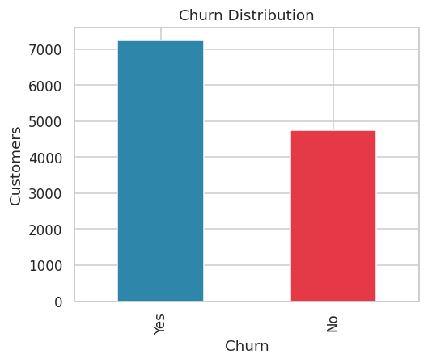
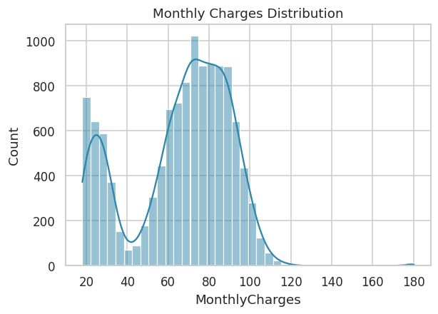
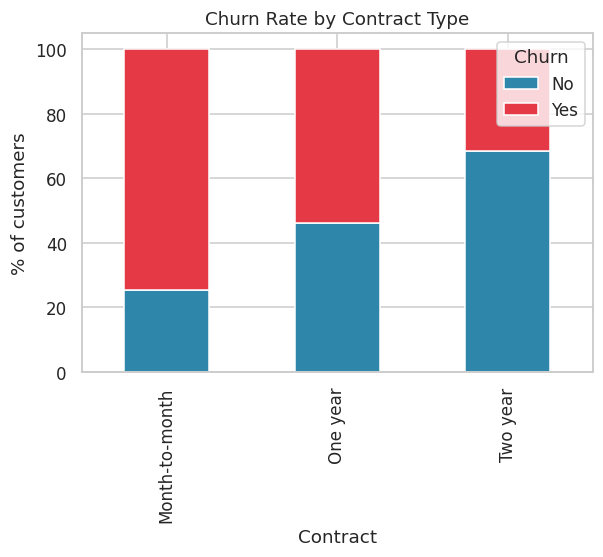
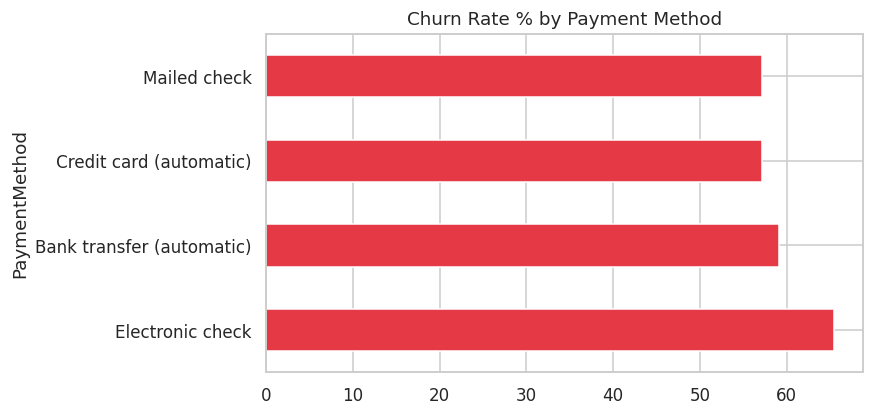
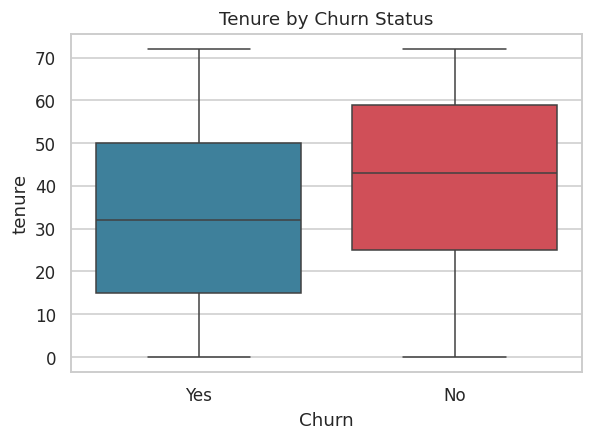
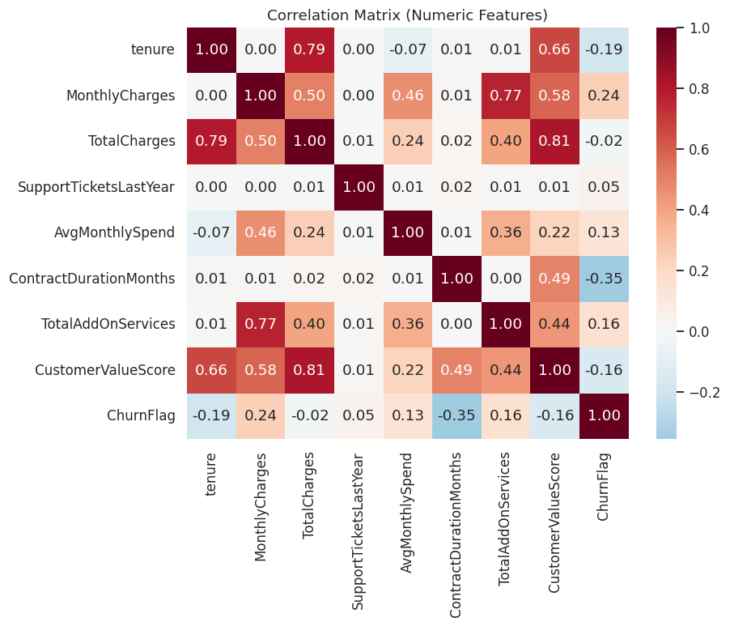
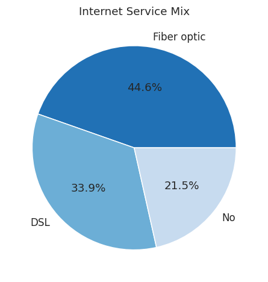
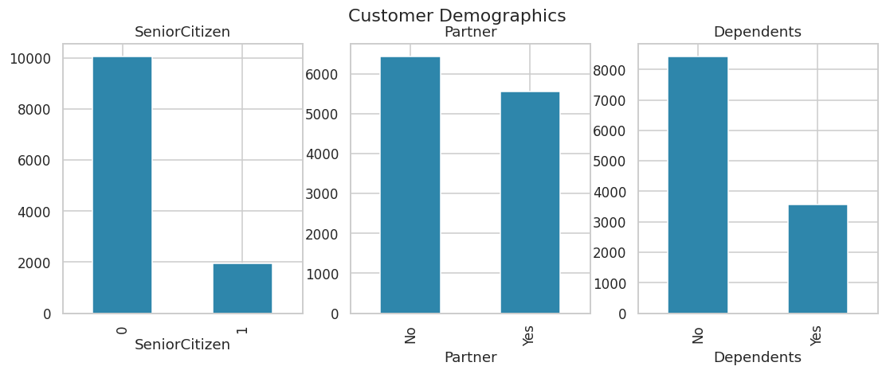
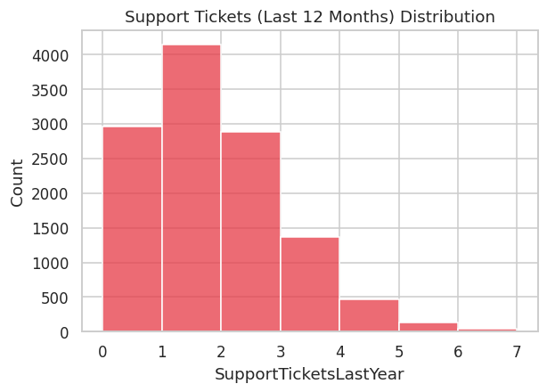
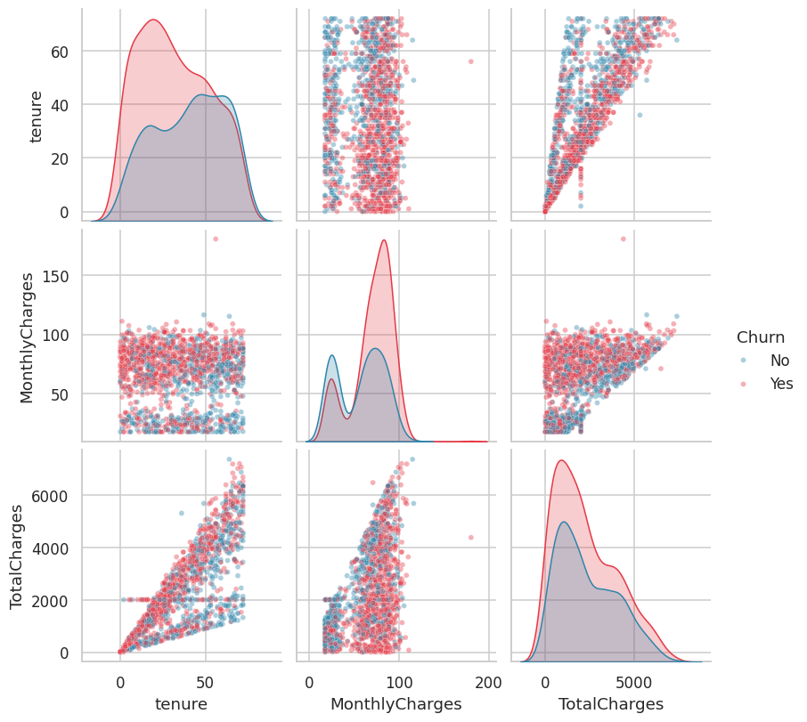

# Exploratory Data Analysis Report

Dataset: 12,000 customers, 35 columns after feature engineering.

## 1. Churn Distribution

**Insight:** Overall churn rate is **60.4%**. This is the baseline the ML model must beat, and the class imbalance means accuracy alone is a misleading metric (see Phase 9 -- we prioritize recall/F1 instead).

## 2. Monthly Charges Distribution

**Insight:** Charges show a multi-modal pattern driven by internet service tier (DSL vs Fiber vs None), median $71.14/mo. This justifies segmenting pricing analysis by service tier rather than treating revenue as one uniform bucket.

## 3. Churn by Contract Type

**Insight:** Month-to-month customers churn at **74.6%** vs **31.4%** for two-year contracts. This is the single strongest retention lever available: incentivizing contract upgrades (e.g., a discount for switching to annual billing) should be the #1 recommendation.

## 4. Churn by Payment Method

**Insight:** Electronic check payers churn substantially more than autopay customers. Nudging customers toward autopay (small incentive) is a low-cost retention lever.

## 5. Tenure vs Churn (Boxplot)

**Insight:** Churned customers cluster at low tenure -- the first 12 months are the highest-risk window. Onboarding and early-lifecycle engagement campaigns should be prioritized over late-tenure retention spend.

## 6. Correlation Matrix

**Insight:** Strongest linear correlates of churn are ContractDurationMonths, MonthlyCharges, tenure. Note correlation != causation -- these guide feature selection for the ML model in Phase 9, not standalone conclusions.

## 7. Internet Service Mix

**Insight:** Fiber optic is the largest segment but (per query Q45 in analytical_queries.sql) also has the highest churn rate -- likely a pricing or service-quality issue worth a targeted satisfaction survey.

## 8. Customer Demographics

**Insight:** Senior citizens are a minority of the base but (per statistical testing in Phase 7) churn at a significantly different rate -- see Statistical_Analysis_Report.md for the chi-square test result.

## 9. Support Ticket Volume

**Insight:** Most customers file 0-2 tickets/year; customers with 3+ tickets are a small but high-risk group worth proactive outreach before renewal.

## 10. Pair Plot (Tenure / Charges)

**Insight:** Churned customers concentrate in the low-tenure, mid-to-high monthly charge region -- consistent with the 'new customer, higher price shock' churn pattern seen in telecom broadly.
